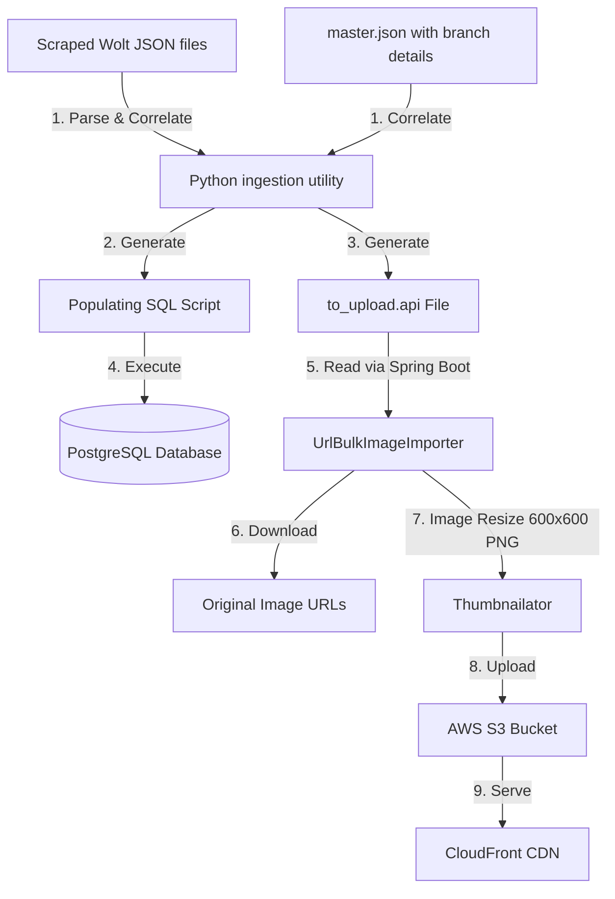

# Data Ingestion & Scraping Pipeline

This document describes the end-to-end data ingestion pipeline used to scrape, parse, database-populate, and optimize restaurant and menu assets for **Flavor Fusion (FoodApp)**.



---

## 1. Phase 1: Python Ingestion & SQL Generator

The Python ingestion script (`process_restaurant.py`) processes scraped JSON assortments of a restaurant, correlates them with venue information, assigns contiguous database sequences, and outputs both a SQL populate script and an image manifest.

### Input Folder Structure
The Python script expects a restaurant-specific folder containing:
- **`master.json`** (optional): Contains Wolt section items representing the branches/venues. This file maps Wolt branch slugs to names, physical addresses, and geographical coordinates.
- **`assortment-{branch-slug}.json`** or **`assortment.json`**: Contains Wolt categories, items, prices, descriptions, options/modifiers, and image URLs.
- **`{restaurant_name}.json`**: The primary JSON file containing general restaurant metadata.

### Command Parameters
Run the Python script with the following arguments to specify the start of ID ranges (sequences) in the PostgreSQL database:

```bash
python process_restaurant.py <folder_path> \
  --users <user_seq_start> \
  --rest <restaurant_id> \
  --loc <location_seq_start> \
  --cat <category_seq_start> \
  --og <option_group_seq_start> \
  --ov <option_variant_seq_start> \
  --menu <menu_seq_start> \
  --bmi <branch_menu_item_seq_start> \
  --desc "Optional description of the restaurant"
```

### Generation Logic

#### Database Sequences
The script reads current sequence positions and increments them to generate unique database keys for:
- **Restaurant Manager**: Created with Role `3` (`restaurant_manager`).
- **Branch Managers**: One per branch with Role `4` (`branch_manager`) and structured emails like `astir@burgerking.al` (using the last part of the branch slug).
- **Restaurant Locations & Opening Hours**: Location coordinates are loaded from `master.json` as WKT `POINT(longitude latitude)` using `ST_GeomFromText`. Default hours are set from `09:00:00` to `23:00:00` daily.
- **Payment Methods**: Automatically connects cash (ID `1`) and credit card (ID `3`) payment methods to the branch.
- **Categories, Menu Options, & Option Variants**: Normalizes shared categories and modifiers across Wolt's options structure.
- **Branch Menu Items**: Automatically maps items available in each branch, and randomly highlights up to 4 items per branch (`is_highlighted = true`).

#### Output Files
1. **`{restaurant_name}_populating_db.sql`**: A complete SQL script containing bulk `INSERT ... ON CONFLICT DO NOTHING` statements ready to run on PostgreSQL.
2. **`to_upload.api`**: A whitespace-separated image manifest mapping destination CloudFront folders, optimized filenames, and original scraped image URLs.
   Format:
   ```text
   <restaurant_folder_name> <target_filename.png> <original_web_image_url>
   ```

---

## 2. Phase 2: Bulk Image Downloader & CDN Uploader

To avoid hosting high-resolution or heavy original URLs directly from scraping sources, the Spring Boot backend contains a utility (`UrlBulkImageImporter`) to process the `to_upload.api` manifest, optimize images, and upload them to AWS S3.

### Implementation Class
The importer is run as a console command runner in Spring Boot:

```java
@Slf4j
@Component
@Profile("import_url")
@RequiredArgsConstructor
public class UrlBulkImageImporter implements CommandLineRunner {
    ...
}
```

### Operational Steps
1. **Activate the Profile**: Run the Spring Boot backend with the active profile `-Dspring.profiles.active=import_url`.
2. **Read Manifest**: The importer reads `/json/restaurants/to_upload.api` from classpath resources.
3. **Parse and Standardize**:
   - Skips empty lines and splits entries.
   - Cleans filenames by stripping query parameters (e.g. `?w=1080` or resizing tags) to prevent `AccessDenied` errors in S3.
   - Renames file extensions to `.png` to match optimized format.
4. **Download**: Fetches the original image bytes via `RestTemplate`.
5. **Optimize**: Uses `Thumbnailator` to resize the downloaded image down to a fast-loading size of **`600x600`** and outputs it strictly as a compressed **`png`**.
6. **AWS S3 Upload**: Sends the optimized image bytes to AWS S3 under the key pattern `folder/filename.png` with a MIME-type of `image/png`.
7. **CloudFront Distribution**: Images are instantly available via CloudFront CDN:
   `https://d3u269mlo8clta.cloudfront.net/{restaurantName}/filename.png`

---

## 3. Walkthrough: Adding a New Restaurant

Follow this standard manual procedure to ingest a new restaurant into Flavor Fusion:

### Step 1: Prepare the Scraped JSON Files
Create a new folder under your workspace (e.g., `./scraped/burger-king`) and place your Wolt scraped JSON files inside. Ensure you have the branch assortments (`assortment-*.json`) and the optional `master.json`.

### Step 2: Determine Current Database Sequence Offsets
Query your database to find the maximum IDs currently used so you don't create overlapping records:
```sql
SELECT MAX(id) FROM users;
SELECT MAX(id) FROM restaurant;
SELECT MAX(id) FROM restaurant_locations;
SELECT MAX(id) FROM categories;
SELECT MAX(id) FROM option_group;
SELECT MAX(id) FROM option_variant;
SELECT MAX(id) FROM menus;
SELECT MAX(id) FROM branch_menu_items;
```

### Step 3: Run the Ingestion Script
Run the Python script using the offsets fetched in Step 2:
```bash
python process_restaurant.py ./scraped/burger-king \
  --users 150 \
  --rest 12 \
  --loc 40 \
  --cat 200 \
  --og 500 \
  --ov 1200 \
  --menu 800 \
  --bmi 2500 \
  --desc "Burger King - Taste is King!"
```

### Step 4: Run the Generated SQL Script
Import the generated SQL file (`burger-king_populating_db.sql`) into your PostgreSQL database:
```bash
psql -U username -d foodapp_db -f ./scraped/burger-king/burger-king_populating_db.sql
```

### Step 5: Upload Cover & Profile Images (Manual)
Since cover and profile images cannot be easily scraped in a structured format:
1. Place custom cover and profile photos under the restaurant image directory.
2. Save them using the naming convention:
   - Cover: `{restaurant_name}_cover.png`
   - Profile: `{restaurant_name}_profile.png`
3. Upload them to the S3 bucket under the restaurant's folder.

### Step 6: Import & Optimize Menu Item Images
1. Copy the generated `to_upload.api` file into the Spring Boot resource directory:
   `backend/src/main/resources/json/restaurants/to_upload.api`
2. Run your Spring Boot application with the `import_url` profile:
   ```bash
   mvn spring-boot:run -Dspring-boot.run.profiles=import_url
   ```
3. Verify that all menu item images are processed, optimized, uploaded to S3, and can be resolved through CloudFront CDN.